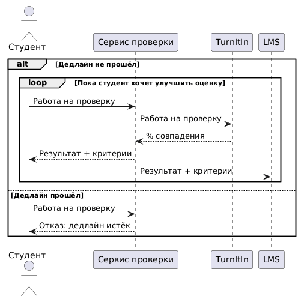
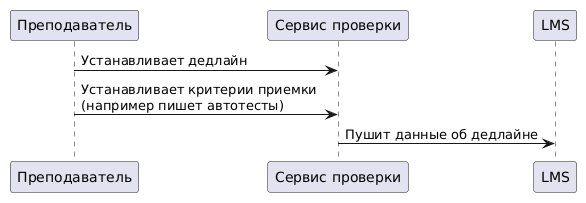
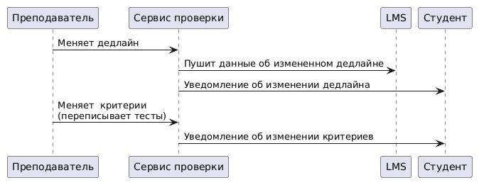
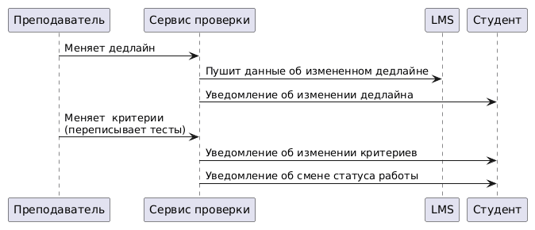
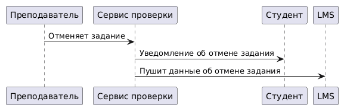
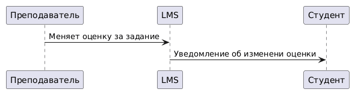
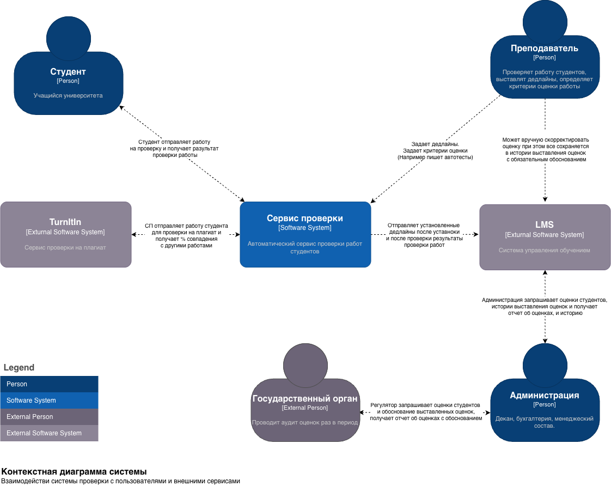

# ДЗ 1 - Представления архитектуры

## Задача

Университет значительно расширил курс по компьютерным наукам и хочет автоматизировать проверку простых заданий по программированию.

1. Пользователи: более 300 студентов в год, а также сотрудники и администрация.
2. Требования:

- учащиеся должны иметь возможность загружать свой исходный код, который будет выполняться и оцениваться
- оценки и прогоны должны быть постоянными и поддаваться аудиту
- требуется система обнаружения плагиата, включающая сравнение с другими представленными материалами, а также отправку в веб-сервис (TurnItIn).
- требуется интеграция с университетской системой управления обучением (LMS).
- профессор устанавливает дату и время сдачи, после чего заявки отклоняются.
- учащиеся могут подавать столько попыток, сколько они хотят улучшить свою оценку.
- преподаватели определяют критерии оценки, которые могут включать показатели и / или тесты.

1. Дополнительный контекст:

- LMS университета основана на мэйнфреймах, и в нее довольно сложно вносить изменения.
- оценки ежегодно проверяются государственным регулирующим органом.
- У университета на ЭТО очень мало средств, поскольку он строит запасной стадион для спортивного мяча
- Университет является рекордсменом по количеству выпускников CS с самыми высокими показателями в стране

## Бизнес-контекст

Заказчик - университет, организует курсы по программированию. В процессе прохождения курсов студенты выполняют домашние задания, а преподаватели их проверяют. Курс был значительно расширен, из-за чего возрос объём работ по проверке заданий и нагрузка на преподавателей.

Важные моменты:

- Университет регулируется государственным органом и ежегодно проводится аудит оценок
- Университет имеет высокие показатели среди выпускников
- Бюджет проекта существенно ограничен
- Есть система управления обучением - LMS на мейнфрейме, менять сложно

## Бизнес-цели, бизнес-драйверы, бизнес-ценности

Цели

- Снизить нагрузку на преподавателей при проверке простых програмных заданий не менее чем на 30% за первый семестр использования системы по сравнению с сопоставимым семестром без автоматизации.
- Обеспечить масштабируемость процесса без пропорционального увеличения затрат. При увеличении студентов с 300 до 600 в год, суммарное время проверок работ преподавателями должно увеличиться не более чем на 50%
- Сохранить качество и прозрачность оценки работ(уточнить критерии оценки работ для ориентира)
- Сохранить высокий показатель у выпускников(уточнить текщие показатели студентов, для ориентира)

30% и 50% — предлагаемые учебные допущения, неподтверждённые заказчиком.

Драйверы

- Повышение кол-ва студентов
- Повышение кол-ва проверяемых работ
- Повышение нагрузки на преподавателей при текущем процессе проверки
- Обязательный ежегодный государственный аудит оценок

Ценности

- Высокий уровень подготовки выпускников
- Академическая репутация университета
- Доверие к выставляемым оценкам

## Стейкхолдеры и их потребности

Студенты

- Загрузить код и получить быструю и понятную обратную связь
- Возможность повторной попытки сдать работу столько раз сколько нужно, для улучшения оценки
- Понять что повлияло на оценку

Приеподватели

- Снизить объем ручной проверки, при этом сохранить контроль и возможность при необходимости принимать участие, например в спорных случаях
- Определить дедлайн сдачи работы на проверку
- Определить критерии выставления оценки

Администрация университета

- Прохождение регулярного аудита
- Сохранение качества обучения и высокого уровня результатов выпускников 
- Снижение стоимости проверки

Государственный регулирующий орган

- Доступ к истории выставления оценок для понимая как и почему была выставлена оценка, и достоверность выставленной оценки

## Пользовательские сценарии

### Студент отправляет работу на проверку

**Бизнес-правила из условия задачи**

1. Студент может отправлять неограниченное количество попыток до наступления дедлайна.
2. После наступления дедлайна новые попытки не принимаются.
3. Результаты проверок и оценки сохраняются для последующего аудита.

**Правила, принятые при проектировании**

1. Каждая новая отправка работы студентом создаёт отдельную попытку. Предыдущие попытки и их результаты сохраняются в истории.
2. Автоматический повтор после технического сбоя относится к той же попытке.
3. Приём работы на проверку и успешное выполнение основных критериев фиксируются отдельно. Приём подтверждается после сохранения попытки и задания на проверку. Работа считается успешно сданной, когда удовлетворяет всем основным критериям задания.

**Предположения, требующие подтверждения**

1. Факт успешной сдачи работы не отменяется последующей попыткой с худшим результатом. Версия работы, по которой зафиксирована успешная сдача, сохраняется.
2. Итоговая оценка на конец дедлайна считается финальной, а факт успешной сдачи сохраняется отдельно. Правило определения этой оценки по нескольким попыткам ещё не выбрано.

### Преподаватель устанавливает дедлайн и критерии приемки

**Бизнес-правила из условия задачи**

1. Преподаватель определяет критерии оценки, которые могут включать показатели и тесты.
2. Преподаватель устанавливает дату и время окончания приёма работ.

**Правила, принятые при проектировании**

1. Критерии и дедлайн задаются для конкретного задания в интерфейсе Сервиса проверки.

**Предположения, требующие подтверждения**

1. Преподаватель может менять критерии и дедлайн. После наступления дедлайна изменение критериев запрещено.
2. Критерии и дедлайн настраиваются для одного задания за одну операцию.
3. Если изменение критериев влияет на статус ранее сданной работы, студент получает уведомление. Изменения критериев и статуса сохраняются в истории. Повторная отправка студентом доступна только до дедлайна.

Диаграммы изменения критериев, дедлайна и отмены задания ниже иллюстрируют предполагаемые варианты поведения, требующие подтверждения.

**Преподаватель устанавливает дедлайн и критерии**

**Преподаватель меняет дедлайн и критерии(Работа еще не сдана)**

**Преподаватель меняет дедлайн и критерии(Работа уже сдана)**

**Преподаватель отменяет задание**

**Разрешение спорного случая**

### Открытые вопросы

1. Как изменение критериев влияет на статус и оценку ранее сданных работ? Требуется ли их повторная проверка?
2. Какая попытка определяет итоговую оценку задания и какая оценка передаётся в LMS?
3. Может ли новая попытка снизить итоговую оценку задания?
4. Как учитываются результаты проверок, завершившихся после дедлайна, если сами работы были приняты до него?
5. Должны ли все попытки быть видны студенту и преподавателю?

## Атрибуты качества (и нефункциональные требования)

| Атрибуты качества                                         | Характеристики                                                                                                                                                                                         | Сценарии                                                                                                                                                                                                                                                                                                                                                                                                                                           |
| --------------------------------------------------------- | ------------------------------------------------------------------------------------------------------------------------------------------------------------------------------------------------------ | -------------------------------------------------------------------------------------------------------------------------------------------------------------------------------------------------------------------------------------------------------------------------------------------------------------------------------------------------------------------------------------------------------------------------------------------------- |
| Масштабируемость                                          | - Стоимость масштабирования  - Деградация производительности                                                                                                                                            | - Количество студентов в год выросло с 300 до 600. Стоимость обработки одной работы выросло не более чем на 10%(1)  - Нагрузка на сервис удвоилась, сервис сохраняет приемлемое время отклика, среднее время проверки растет не более чем на 10%(1)   1 - гипотетические данные для предметности сценария. Реальные данные будут представлены заказчиком                                                                                      |
| Производительность                                        | - Время подтверждения приёма работы - Полное время проверки работы - Объем обрабатываемых операций в минуту - Предельная нагрузка | Перед дедлайном нагрузка выросла с 10 до 20 отправок в минуту.  - Для 99% отправленных работ студент видит подтверждение приёма на проверку не позднее одной секунды после завершения загрузки файлов. - Для 99% принятых работ итоговый результат доступен не позднее пяти минут после подтверждения приёма. Время включает ожидание в очереди и все обязательные проверки при доступных внешних сервисах. - При нагрузке выше 20 отправок в минуту время ожидания может увеличиваться, но система продолжает работать.  Числовые показатели — учебные допущения, требующие подтверждения заказчиком и проверки под нагрузкой. |
| Безопасность                                              | - Последствия запуска вредоносного кода - Последствия получения доступа к данным вне системы  - Ущерб от успешной атаки  - Влияние атаки одним пользователем на всю систему  - Изоляция исполняемого кода | - Студент загружает программу, которая пытается прочитать данные других студентов. Система изолирует выполнение кода, нет возможности получить данные другого студента  - Студент пытается получить доступ к внешней среде, чтобы подменить оценки. Система изолирует действия, нет возможности совершать действия вне системы                                                                                                                      |
| Отказоустойчивость                                        | - Объем потерянных данных при отказе системы  - Время восстановление  - Последствия отказа  - Доступность системы  - Возможность восстановления  - Сохранение согласованного состояния                      | - Во время отправки работы происходит сбой. Студент получает сообщение об ошибке и может повторить отправку. - После приёма работы происходит сбой. Принятая работа и сохранённые результаты не теряются. После восстановления система продолжает обработку. Если проверку завершить не удалось, студент получает сообщение об ошибке. |
| Аудируемость                                              | - Возможность восстановить историю изменений и выставления оценки  - Невозможность неконтролируемого изменения или подмены оценки                                                                       | - Гос орган запрашивает обоснование выставления оценок. Есть возможность передать историю выставления оценок  - Преподавателю необходимо выяснить почему была выставлена конкретная оценка. Есть возможность просмотреть исто                                                                                                                                                                                                                       |
| Целостность данных                                        | - Сохранность оценок  - Сохранность истории                                                                                                                                                             | - Студент отправляет работу на перепроверку, при этом результат и последовательность предыдущих проверок не должны быть утеряны  - При ручном изменении оценки сохраняется информация об изменении                                                                                                                                                                                                                                                  |
| Устойчивая интеграция с внешними сервисами(LMS, TurnItIn) | - Отправка данных  - Получение данных  - Обработка ошибок                                                                                                                                                | Во время проверки или передачи оценки TurnItIn либо LMS становится недоступна. Данные не теряются. Система самостоятельно повторяет обращение после восстановления доступности внешнего сервиса. |

## Контекстная схема системы

## Критические сценарии и критические характеристики

| Характеристика                                           | Сценарий                                                                                                          | Почему критично                                                                                                       |
| -------------------------------------------------------- | ----------------------------------------------------------------------------------------------------------------- | --------------------------------------------------------------------------------------------------------------------- |
| Время проверки работы / производительность под нагрузкой | Перед дедлайном большое количество студентов одновременно отправляет работы на проверку                           | Количество попыток не ограничено, поэтому в пиковые периоды очередь может резко расти                                 |
| Сохранность оценок и истории                             | Государственный орган запрашивает обоснование выставленной оценки                                                 | Университет обязан проходить ежегодный аудит                                                                          |
| Изоляция исполняемого кода                               | Студент загружает программу, которая пытается получить доступ к данным или ресурсам за пределами среды выполнения | Система исполняет непроверенный пользовательский код, поэтому один запуск не должен влиять на данные и инфраструктуру |
| Последствия отказа                                       | Во время сохранения оценки происходит сбой                                                                        | Потеря или искажение результата нарушает требования к сохранности данных и аудиту                                     |

## 2 первых архитектурных решения запишите в виде ADR

[Решение 1](./001-размещение-критериев-оценки.md)
[Решение 2](./002-запуск-кода-студентов.md)
